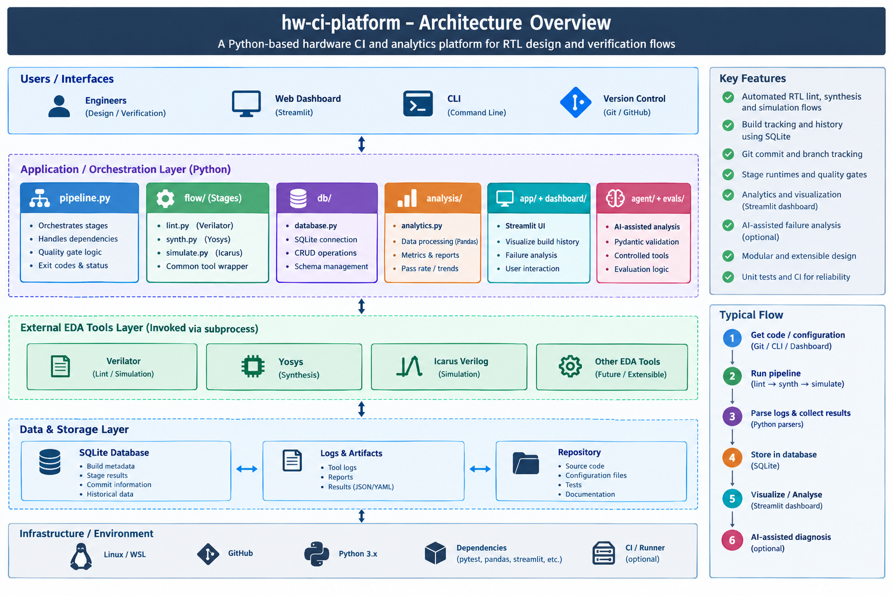
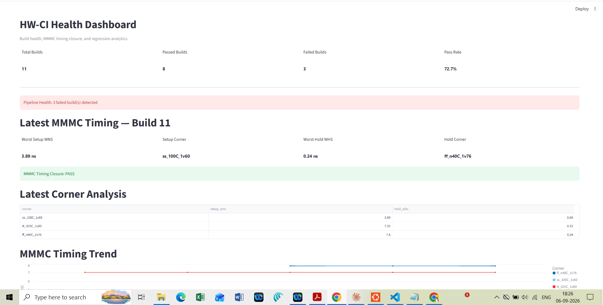

# HW-CI Health Platform

A Python-based CI/CD and analytics platform for multi-IP ASIC/SoC hardware repositories. It automatically runs RTL quality checks, records build history and runtime metrics, and provides a Streamlit dashboard for build health analysis.



## Dashboard

The Streamlit dashboard provides build health, pass/fail statistics, runtime trends, and build history.



## Overview

This MVP demonstrates a hardware-focused CI pipeline using open-source EDA tools:

```text
Git Commit
    │
    ▼
┌──────────┐
│   Lint   │  Verilator
└────┬─────┘
     ▼
┌──────────┐
│ Synthesis│  Yosys
└────┬─────┘
     ▼
┌──────────┐
│Simulation│  Icarus Verilog
└────┬─────┘
     ▼
┌──────────┐
│  SQLite  │  Build history
└────┬─────┘
     ▼
┌──────────────┐
│  Streamlit   │
│  Dashboard   │
└──────────────┘
```

## Features

* Works on any RTL repository: files, top module and testbench are discovered or configured with `hwci.toml`
* Automated RTL linting with Verilator
* RTL synthesis checks with Yosys
* RTL simulation with Icarus Verilog
* Git branch and commit traceability
* SQLite-based build and stage history
* Pipeline runtime and failure analytics
* Streamlit build-health dashboard
* Quality-gate ready architecture
* Designed for multiple hardware/IP repositories

## Technology Stack

| Component       | Technology            |
| --------------- | --------------------- |
| Language        | Python                |
| Version Control | Git                   |
| Lint            | Verilator             |
| Synthesis       | Yosys                 |
| Simulation      | Icarus Verilog        |
| Database        | SQLite                |
| Analytics       | Python                |
| Dashboard       | Streamlit + Pandas    |
| Test Repository | Asynchronous FIFO RTL |

## Quick Start

Clone the project:

```bash
git clone https://github.com/YOUR_USERNAME/hw-ci-platform.git
cd hw-ci-platform
```

Create a Python environment:

```bash
python3 -m venv .venv
source .venv/bin/activate
pip install streamlit pandas
```

Initialize the database:

```bash
sqlite3 db/build.db < db/schema.sql
```

The platform expects a hardware repository separately. For the MVP testbench:

```bash
git clone https://github.com/SarangKudtarkar/RTL2GDS-Asynchronous-FIFO.git input-repo
```

Run the complete pipeline on a repository (RTL files, top module and testbench are discovered automatically):

```bash
python3 flow/pipeline.py ../input-repo
```

The original explicit form still works:

```bash
python3 flow/pipeline.py \
    ../input-repo/async_fifo.v \
    ../input-repo/async_fifo_tb.v \
    async_fifo \
    ../input-repo
```

See [Running on your own design](#running-on-your-own-design) for any other IP, such as an adder.

Run analytics:

```bash
python3 analysis/analytics.py
```

Launch the dashboard:

```bash
streamlit run dashboard/app.py
```

## Running on your own design

The pipeline is not tied to any IP. Point it at a repository folder:

```bash
python3 flow/pipeline.py path/to/my-adder
```

With no configuration it looks for:

| What | How it is found |
| ---- | --------------- |
| RTL files | `.v`/`.sv` files in `src/`, `rtl/`, `hdl/` or `design/` (first one that has RTL), else the repository root, else anywhere. Testbenches and generated folders (`results/`, `logs/`, `reports/`, ...) are excluded. |
| Top module | The one module that no other module instantiates. If there are several, pass `--top`. |
| Testbench | A file named `*_tb`, `tb_*`, `*_test`, ... (preferring one named after the top), or one that calls `$finish`. |

Anything can be overridden on the command line (`--top`, `--rtl a.v b.v`, `--tb tb.v`, `--name`) or in an `hwci.toml` at the repository root:

```toml
name = "adder"                 # label shown in build history (default: top)
top  = "adder"
rtl  = ["src/*.v"]             # globs relative to the repository
include_dirs = ["src/include"]
defines = ["WIDTH=8"]

[sim]
testbench  = "tb/adder_tb.v"
top        = "adder_tb"        # optional: iverilog -s
pass_regex = "TEST PASSED"     # optional: must appear in the output
fail_regex = "\\b(ERROR|FAIL|FAILED|MISMATCH)\\b"  # optional: must not appear (this is the default)

[sta]
mode    = "auto"               # auto | require | skip
netlist = "results/routing/adder.nl.v"   # defaults follow the OpenLane layout
sdc     = "src/adder.sdc"
spef    = "results/routing/mca/spef/adder.nom.spef"
```

Precedence is command-line options, then `hwci.toml`, then discovery. A starting point to copy is in `tests/fixtures/adder/`.

### How a stage passes

* **Lint / synthesis** pass when Verilator / Yosys exit cleanly. Synthesis also fails if a module is instantiated but missing from the RTL files.
* **Simulation** passes when the simulator exits 0, the output contains no `ERROR`, `FAIL`, `FAILED` or `MISMATCH` (upper case, whole word), and `pass_regex` appears if one is set. Testbenches usually print a failure and then call `$finish`, which exits 0, so the exit code alone is not trusted.
* **MMMC STA** needs a routed netlist, SDC and SPEF from an OpenLane run, and Docker. `--sta auto` (the default) runs it only when those files exist and otherwise skips it, so purely RTL-level designs such as a small adder still get a pass/fail result. `--sta require` fails the build if they are missing, and `--sta skip` never runs it. The original four-argument form behaves as `require`.
  The input repository must live under the same parent directory as this project, because that directory is what is mounted into the Docker container.

If no testbench is found the simulation stage is skipped with a warning.

Outputs for each design go to `results/<name>/`, and every build records the design name, so timing regressions are only ever compared against earlier builds of the same design.

## Pipeline

Each build records:

* Design name
* Git branch
* Git commit SHA
* Overall PASS/FAIL status
* Total runtime
* Individual stage status
* Individual stage runtime

The pipeline stops when a quality stage fails, preventing later stages from running unnecessarily.

## Dashboard

The Streamlit dashboard provides:

* Total builds
* Passed/failed builds
* Pass rate
* Pipeline health
* Runtime trend
* Build history
* Commit traceability
* Average pipeline runtime

## AI-assisted hardware CI failure analysis using Gemini, controlled read-only tools, SQLite, and Pydantic validation.

## Setup
```bash
source .venv/bin/activate
pip install -e ".[test]"
export GEMINI_API_KEY="your-key"
```

## Commands
```bash
# Run local tests (no API calls)
python -m pytest tests/ -v -m "not integration"

# Analyze build 8
python -m app.analyze 8

# Run live integration test
python -m pytest tests/test_agent_integration.py -v -m integration

# Run live evaluations
python -m evals.run_evals
```

## Repository Structure

```text
hw-ci-platform/
├── analysis/
│   └── analytics.py
├── dashboard/
│   └── app.py
├── db/
│   ├── build.db
│   ├── database.py
│   └── schema.sql
├── flow/
│   ├── design_config.py
│   ├── lint.py
│   ├── synth.py
│   ├── simulate.py
│   └── pipeline.py
├── vcs/
├── farm/
├── config/
├── logs/
├── results/
├── .gitignore
└── README.md
```

The hardware repository is kept separately from the platform so the same CI framework can analyze different IP/RTL repositories.

## Concepts Demonstrated

**CI/CD:** Automatically validate hardware changes on every commit.

**Quality Gates:** A failed lint or synthesis stage prevents later stages from executing.

**Traceability:** Every build is associated with a Git branch and commit.

**Build Analytics:** Historical runtime and failure data can be analyzed to identify regressions.

**Multi-IP Architecture:** The platform is designed to run the same flow against multiple hardware repositories.

## Future Enhancements

* Parallel multi-IP job scheduling
* Formal equivalence checking with EQY/SymbiYosys
* OpenLane RTL-to-GDS flow
* Git pre-push quality gates
* Slack notifications
* Release-readiness metrics
* Runtime regression detection
* Multi-IP dashboard filtering
* Distributed build workers

## Project Goal

The goal is to demonstrate how software-style CI/CD practices can be applied to ASIC/SoC development, providing automated validation, build traceability, quality gates, and engineering analytics across hardware IP repositories.

